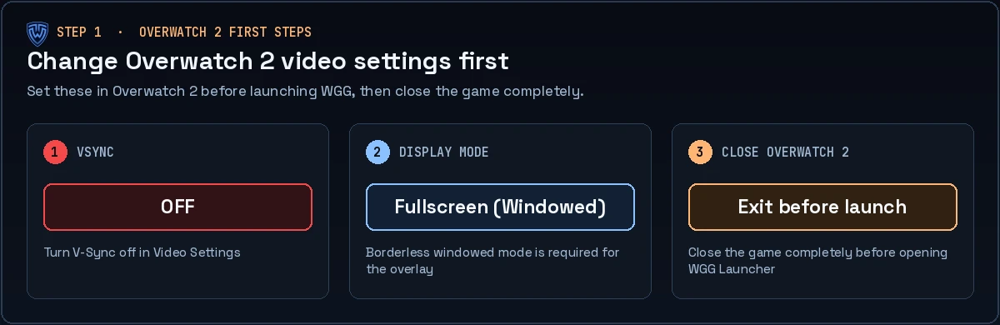
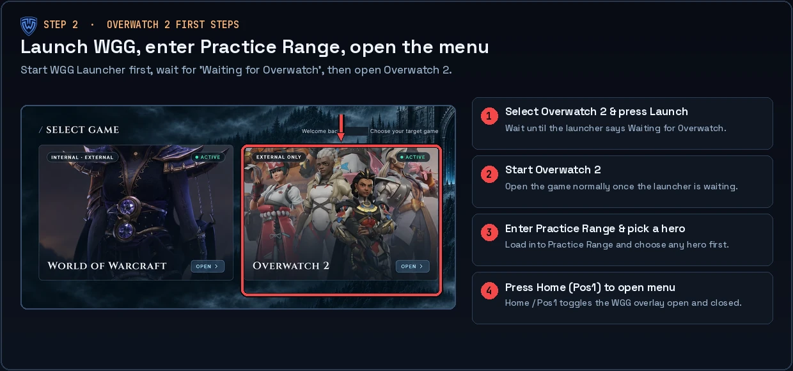
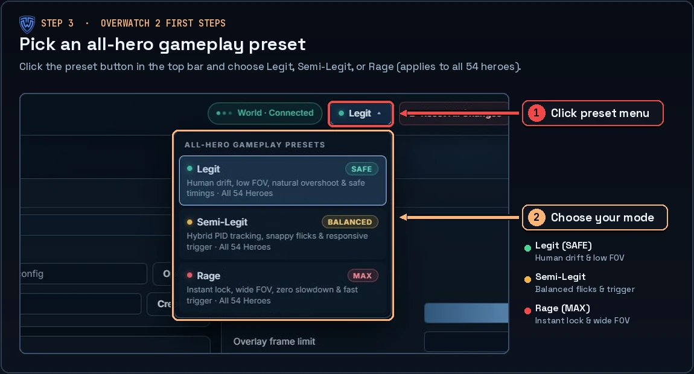
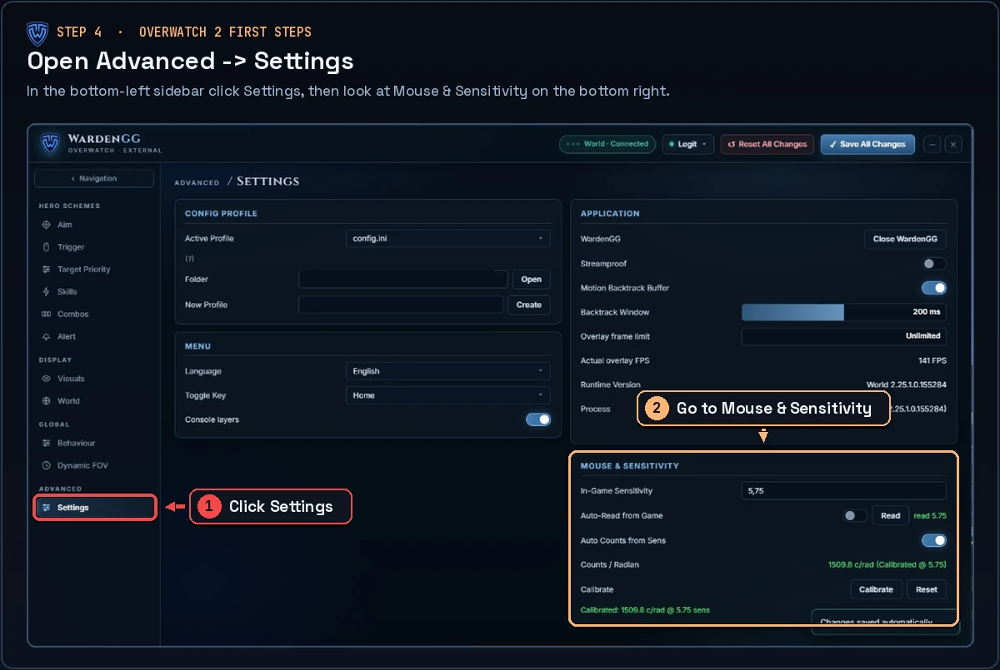
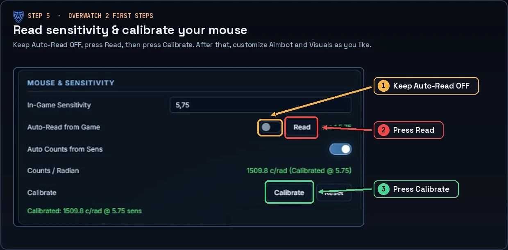

# Overwatch 2 First Steps

Follow these 5 steps before your first match. Overwatch 2 External does not require any script folders or script files.

> **First time using WardenGG on this PC?**
>
> Overwatch 2 uses the exact same Windows requirements and PC preparations as World of Warcraft (Windows 10/11 Pro, TPM 2.0 enabled, Defender/AV off, Vulnerable Driver Blocklist off, HVCI off, Secure Boot off). Complete [Preparations](getting-started.md#preparations) first if you have not already done so, then start at Step 1 below.

## Step 1: Change Overwatch 2 Video Settings First

Before starting WGG for the first time, open Overwatch 2 and set:

- **V-Sync:** `OFF`
- **Display Mode:** `Fullscreen (Windowed)`

Save your settings, then **close Overwatch 2 completely**.

## Step 2: Launch WGG, Enter Practice Range, Open Menu

1. Run the **WardenGG Launcher** as Administrator, select **Overwatch 2**, and press **Launch**.
2. Wait until the launcher reads **Waiting for Overwatch**, then start Overwatch 2.
3. Enter **Practice Range** first and pick any hero.
4. Press **Home** (`Pos1` on German/ISO keyboards) to open or close the WGG menu.

While the menu is open, aim output pauses so you can adjust controls safely. You can change the toggle hotkey anytime under **Advanced > Settings > Menu > Toggle Key**.

## Step 3: Pick an All-Hero Gameplay Preset

Click the preset dropdown in the top bar and pick a starting preset (applies across all 54 heroes):

- **Legit (`SAFE`)**: human drift, low FOV, natural overshoot, safe timings.
- **Semi-Legit (`BALANCED`)**: hybrid PID tracking, snappy flicks, responsive trigger.
- **Rage (`MAX`)**: instant lock, wide FOV, zero slowdown, fast trigger.

## Step 4: Open Advanced > Settings

In the bottom-left sidebar, click **Settings** under `ADVANCED`, then locate the **MOUSE & SENSITIVITY** panel on the bottom right.

## Step 5: Read Sensitivity & Calibrate

Inside **MOUSE & SENSITIVITY**:

1. Keep the **Auto-Read from Game** toggle **OFF**.
2. Press **Read** to import your current Overwatch 2 in-game sensitivity.
3. Press **Calibrate** and wait for calibration to finish (the menu briefly focuses the game to measure counts per radian).

Leave **Auto Counts from Sens** enabled for automatic scaling. **Reset** returns to the calculated default if needed.

You are now ready to play. Customize **Aim**, **Trigger**, **Skills**, **Combos**, **Alert**, and **Visuals** per hero whenever you want.

---

## Check the screen

In **Settings > Screen**, verify that **Target Screen** matches the monitor running Overwatch 2. **Pause while chatting** and **Pause when game loses focus** are located under **Host state pause**. If overlays or FOV rings look offset, recheck Fullscreen (Windowed) and Target Screen before editing hero profiles.

## Choose a hero scope

Use **All** for shared fallback settings, or select a specific hero in the sidebar to edit that hero alone. **Follow current hero** switches the active page automatically as you swap heroes in-game.

## Save your changes

Changes save automatically after a brief pause. Click **Save All Changes** to save right away, or **Reset All Changes** to restore defaults across heroes. Create a new profile first if you want a backup before experimenting.
