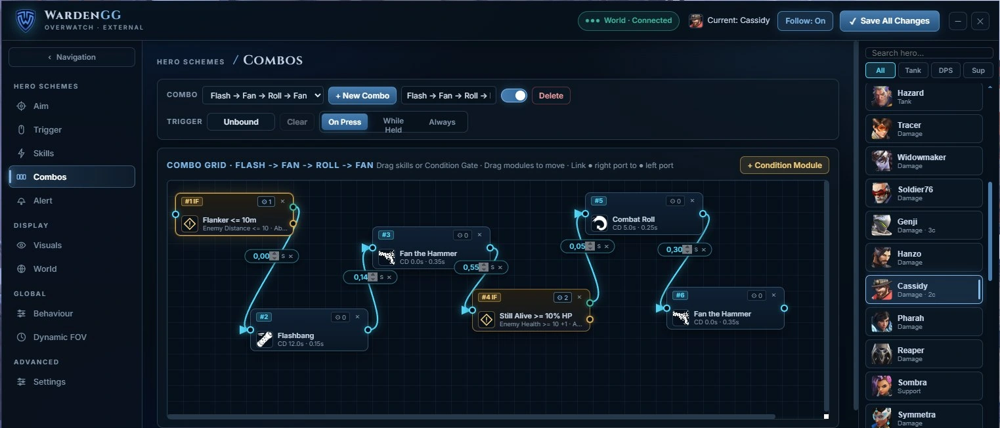

# Overwatch 2 External

Find the WardenGG setup steps and a reference for each area of the Overwatch menu.

## Start here

Read [Getting started](overwatch-setup.md) to open the menu, check your display, calibrate sensitivity and make sure your settings are being saved.

## Menu reference

| Menu area | What you’ll find |
| --- | --- |
| [Hero schemes](overwatch-hero-schemes.md) | How the global fallback, individual hero profiles, aim slots, trigger and target rules relate to each other. |
| [Skills, combos and alerts](overwatch-combos.md) | How to read the visual combo editor, understand condition branches and manage notifications. |
| [Visuals and display](overwatch-display.md) | Player and world overlays, radar, field-of-view rings and display alignment. |
| [Settings and profiles](overwatch-settings.md) | Switching or creating a profile, menu shortcuts, presets and diagnosing configuration issues. |

## Support

Open a ticket in **#technical-support** on Discord. Include your launcher version, game region or build, selected profile and hero, and the name of the menu or control involved. Crop private account details and local paths from any screenshot.
